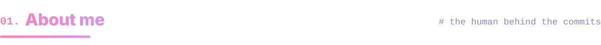
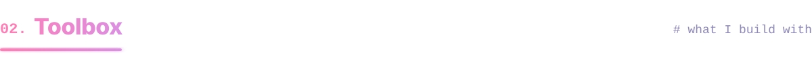
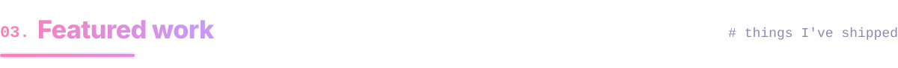
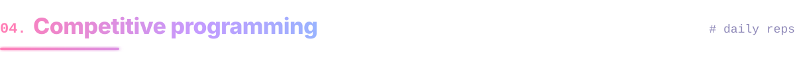
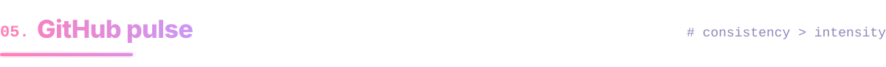

  

  
  
  
  
  

  

 

  

 

<table align="center">
  <tr>
    <td align="center" width="140"><b>💬 Languages</b></td>
    <td></td>
  </tr>
  <tr>
    <td align="center"><b>⚛️ Frameworks</b></td>
    <td></td>
  </tr>
  <tr>
    <td align="center"><b>🗄️ Databases</b></td>
    <td></td>
  </tr>
  <tr>
    <td align="center"><b>📊 Data Science</b></td>
    <td>
      
      
      
      
      
      
    </td>
  </tr>
  <tr>
    <td align="center"><b>🧰 Tools</b></td>
    <td></td>
  </tr>
</table>

 

  
  

 

  

 

  

  <picture>
    <source media="(prefers-color-scheme: dark)" srcset="https://raw.githubusercontent.com/Lidia-Kibret/Lidia-Kibret/output/snake-dark.svg"/>
    
  </picture>

  

